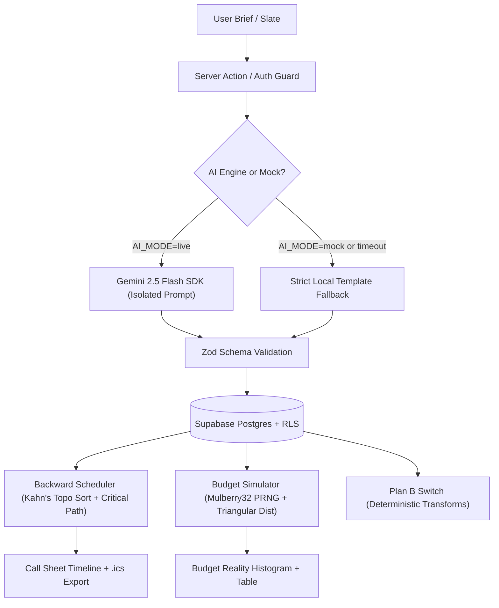

# Standby

> **"Standby. Your event is rehearsed."**

Standby answers **PromptWars Challenge 5 (Celebration & Event Planner)**: a GenAI-powered planning assistant that helps users organize weddings, birthdays, and community events with **budgets**, **timelines**, **vendor checklists**, and **personalized ideas**.

Unlike ordinary planners that treat events as static lists, Standby **rehearses the event on paper** using deterministic simulation, backward dependency scheduling, and crisis pre-mortems before a single dollar is spent.

---

## 🏛️ Architecture & System Design



---

## 🎯 The Nine Rehearsal Features

1. **Slate (Brief)**: Users input constraints and vision (up to 1,500 characters, prompt-injection isolated); Gemini synthesizes a structured production plan with graceful template fallback.
2. **Pre-Mortem**: Identifies exactly 5 catastrophic failure points backward from the event date, pairing each with an actionable **Plan B** contingency.
3. **Money (Budget Reality Simulator)**: Pure mathematical code, **NOT AI**. 2,000 triangular random distribution runs per budget item using a seeded `mulberry32` PRNG. Computes **P50**, **P80**, **P95**, and the exact percent probability of exceeding the target budget. Includes a WCAG AA striped pattern histogram and accessible data table.
4. **Call Sheet (Timeline)**: Tasks scheduled backward from the event call date. Calculates slack days and stamps critical path tasks with an unyielding **HOLD (0d)** badge.
5. **Vendor Checklist**: Categorized vendor tracking with status lifecycle (`to_call`, `quoted`, `booked`, `confirmed`), quotes, and deadlines.
6. **Guest Panel**: AI review playing 4 guest personas (Strict Grandparent, Vegan Friend, Parent with Toddler, Wheelchair User) alongside an event accessibility audit.
7. **Personalized Ideas**: Bespoke atmosphere themes, interactive activities, hospitality menus, and unexpected small touches.
8. **Plan B Switch**: Physical-styled two-position toggle applying deterministic transformations for **Rain**, **Vendor Cancelled**, **Budget Cut 20%**, and **+30 Guests**.
9. **Share & Export**: RFC 5545 `.ics` calendar generation, 7-day expiring token read-only share view (`/share/[token]`), and a print stylesheet for a black-on-white one-page Call Sheet.

---

## 🎨 Design: "Orbit"

- **Landing page**: a full-screen, non-scrolling space hero (planet video, Inter type, glass pill, two-line headline with a mask reveal). Sizes come from a 1563x1006 reference and scale as one unit.
- **App pages**: the same look. Black background, white ink, glass cards, white solid and outline buttons, Inter only.
- **Kept from the stage-manager idea**: Q1/Q2 cue numbers, "RISK n/5" stamps, HOLD badges on the critical path, the PLAN A / PLAN B switch, and striped/dotted histogram bars that work without colour.
- **Contrast**: `npm run check:contrast` checks every colour pair (WCAG AA) and fails the build if one is too low.
- The background video and poster load from an external CDN supplied with the design. ⚠️ UNVERIFIED: that this host stays available long term; copy the files into `public/` if you need guarantees.

---

## 🔑 Make login work (one-time setup)

1. **Create the database tables.** In your Supabase project, run `supabase/migrations/20261101000000_standby_schema.sql` (Dashboard → SQL Editor → paste → Run).
   If the Supabase GitHub integration is connected with migrations enabled, it applies this file when you push to `main`. ⚠️ UNVERIFIED: whether your integration is set to deploy migrations; check Dashboard → Integrations → GitHub.
2. **Copy the keys.** Dashboard → Project Settings → API. Put the Project URL and the `anon` public key in `.env.local` (and in Vercel → Settings → Environment Variables):
   ```bash
   NEXT_PUBLIC_SUPABASE_URL=https://YOUR-REF.supabase.co
   NEXT_PUBLIC_SUPABASE_ANON_KEY=YOUR-ANON-KEY
   GEMINI_API_KEY=            # optional; without it the app uses safe templates
   NEXT_PUBLIC_SITE_URL=http://localhost:3000
   ```
   Never use the service-role key.
3. **Turn on guest mode.** Authentication → Sign In / Providers → enable **Anonymous sign-ins** (needed for "Try as guest").
4. **Allow the email link back.** Authentication → URL Configuration: set Site URL to your site, and add `http://localhost:3000/auth/callback` and `https://YOUR-SITE/auth/callback` to Redirect URLs.
5. **Google sign-in.** Authentication → Sign In / Providers → Google: paste the Client ID and Client Secret from Google Cloud Console (OAuth client, type Web). In Google Cloud, add `https://YOUR-REF.supabase.co/auth/v1/callback` as an Authorized redirect URI. The app then shows **Continue with Google**; the user returns through `/auth/callback`.
6. Restart `npm run dev`. The login page shows a yellow notice while the keys are missing.

---

## ⚡ Keep-Alive & Monitoring

- **`/api/health`**: Dynamic, uncached endpoint that pings the Supabase database and verifies query execution. Returns `{ ok: true, time }` with 200 status, or 503 if unavailable. Never returns secrets.
- **GitHub Actions Workflow (`.github/workflows/keepalive.yml`)**: Executes on a cron schedule every 12 hours. Pings the repository variable `HEALTH_URL` to prevent free database pausing.
- **UptimeRobot Setup**:
  1. Create a free monitor at [UptimeRobot](https://uptimerobot.com).
  2. Set monitor type to `HTTP(s)` pointing to `https://<YOUR-APP>/api/health`.
  3. Set interval to 5 minutes (`⚠️ UNVERIFIED`: verify current free plan interval limits).

---

## ⚙️ Development & Scripts

```bash
# Install dependencies
npm install

# Run contrast verification (enforces WCAG AA)
npm run check:contrast

# Typecheck TypeScript
npm run typecheck

# Run unit and component test suite with coverage
npm test

# Build for production
npm run build

# Run Playwright E2E & Axe accessibility audits
npm run test:e2e
```

---

## 🔒 Environment Variables

| Variable | Required | Description |
|---|---|---|
| `NEXT_PUBLIC_SUPABASE_URL` | Yes | Supabase project URL |
| `NEXT_PUBLIC_SUPABASE_ANON_KEY` | Yes | Supabase public anonymous key (never service-role) |
| `GEMINI_API_KEY` | Optional | Google Gemini API key (server-side only) |
| `GEMINI_MODEL` | Optional | Default `gemini-2.5-flash` |
| `AI_MODE` | Optional | `live` or `mock` (mock returns deterministic templates) |
| `NEXT_PUBLIC_SITE_URL` | Optional | Base URL for share links and metadata |

---

## ⚠️ Unverified Claims & Limits

- ⚠️ **UNVERIFIED**: Free UptimeRobot monitoring interval policy on new free accounts (standard historical free tier is 5 minutes).
- ⚠️ **UNVERIFIED**: Supabase free-tier project pause policy threshold (commonly 7 days of inactivity; mitigated by the keepalive workflow).
- ⚠️ **UNVERIFIED**: Gemini 2.5 Flash free-tier queries-per-minute ceiling in non-US regional deployments.
